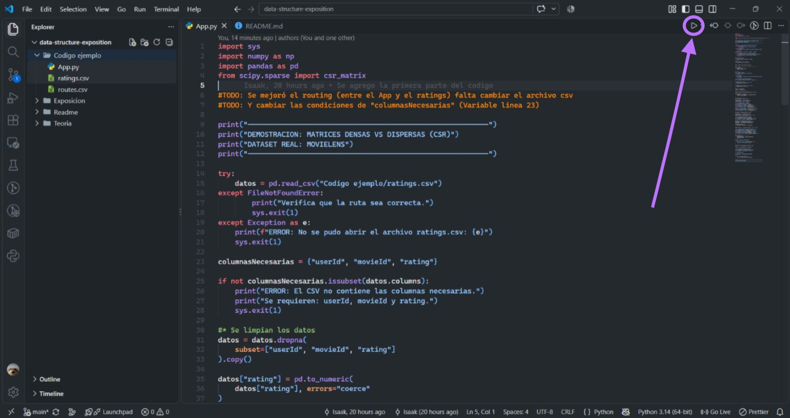
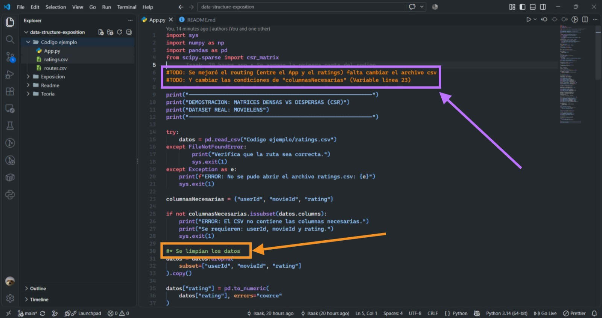

# Red de rutas aéreas

## Descripción
Este proyecto busca representar una red de vuelos entre aeropuertos de forma eficiente, usando matrices dispersas para consumir menos memoria. La idea es identificar cuáles aeropuertos son más importantes mediante el algoritmo PageRank y encontrar la menor cantidad de vuelos necesarios para viajar de una ciudad a otra (En su etapa final, primeramente se le da un uso completamente experimental hasta llegar al resultado deseado). 

## Tecnologías
- Python
- Librerias: sys, numpy, pandas, scipy

## Implementación
En primera instancia se investigó individualmente el tema, posteriormente se realizó una retroalimentación conjunta entre los 3 participantes. Cuando ya se conocía el concepto a tratar se investigó un proyecto interesante de la vida real para aplicar dicho concepto. Cuando se tomó la decisón de que proyecto realizar, los integrantes Isaak Córdoba y Sebastián Mendoza iniciaron la configuración del entorno y el código, mientras, Manuela Salazar daba comienzo a la creación de las diapositivas y todo el marco teoríco necesario para la exposición. 

## Ejecución 
Se requiere para su ejecución (en vs code)
### Escribir el siguiente comando en la terminal (en vs code dentro de la carpeta del proyecto):
- py -m pip install numpy scipy sys
### Usar una extensión para correr el código más cómodamente (recomendada):
- Python debugger / Microsoft

### Usar una extensión para ver los comentarios en colores como en etapa de desarrollo (recomendada):
- Better comments / Aaron Bond

## Correr Uso de memoria/App.py
"""bash
py ".\Codigo ejemplo\Uso de memoria\App.py"
"""
## Correr Vuelos/App.py
"""bash 
py ".\Codigo ejemplo\Vuelos\App.py"
"""

## Resultados:
### Para Uso de memoria:
- =========================================================
- Matriz dispersa de rutas aéreas desde CSV (OpenFlights)
- =========================================================

- Listo, se cargaron las rutas.
- Conexiones únicas: 37,274

- Datos de la matriz de rutas
- Aeropuertos (filas): 3,330
- Aeropuertos (columnas): 3,330
- Dimensiones: 3330 x 3330
- Posiciones totales: 11,088,900
- Conexiones no nulas: 37,274
- Densidad: 0.3361%
- Porcentaje de ceros: 99.6639%

- Matriz densa
- Memoria: 84.6016 MB
- Memoria en bytes: 88,711,200

- Matriz dispersa (CSR)
- Memoria de data: 298,192 bytes
- Memoria de indices: 149,096 bytes
- Memoria de indptr: 13,324 bytes
- Memoria total CSR: 0.4393 MB
- Memoria total en bytes: 460,612

- Ahorro de memoria
- Ahorro de memoria con CSR: 99.48%

- Multiplicacion de matriz por vector
- Primeros 3 resultados:
- [4. 7. 8.]
- Los resultados coinciden: True

### Para Vuelos:
Códigos IATA disponibles:
- (Códigos disponibles)

- Aeropuerto de origen: A
- Aeropuerto de destino: Z
- La ruta con menos viajes es: ['A' , 'B' , 'Z']
- Vuelos: (ruta con menos viajes) - 1

## Autores 
Isaak Córdoba Bermúdez
Manuela Salazar Osorio
Sebastián Mendoza Álvarez